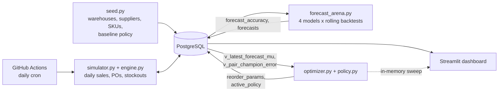

# Technical Documentation

**Supply Chain Inventory Optimization & Demand Forecasting**

This document explains what the system does, why each design choice was made, and how the pieces fit together. The appendices contain reference material: formulas, schema dictionary, view catalog, configuration, CLI commands, and troubleshooting.

---

## 1. Problem statement

A retailer stocks thousands of products across several warehouses. Two things go wrong in opposite directions:

- **Stockouts**: demand arrives and there is no stock. The sale (and its margin) is lost.
- **Overstock**: too much stock sits on shelves, tying up capital and incurring holding cost.

Where the balance falls is decided by two things:

1. **How well future demand is forecast.** Better forecasts mean less safety stock is needed for the same service level.
2. **How the reorder policy turns forecasts and supplier uncertainty into order decisions.**

This project builds a closed loop that does both: a simulated supply chain generates data, forecasting models compete to predict demand, an optimizer converts forecast error and supplier variability into reorder parameters, and the improved policy is fed back into the simulation so its effect can be measured.

### Goals

| Goal | How it is addressed |
|---|---|
| Realistic, continuously changing data at scale (10K SKUs x 3 warehouses = 30,000 stocking points) | Vectorised simulator that advances one day per run and writes to Postgres |
| Honest model comparison | Rolling-origin backtests, 4 models, errors stored in SQL |
| Decisions, not just predictions | Safety-stock optimizer and cost-minimising service-level sweep |
| SQL-heavy analytics | Views using CTEs and window functions (Section 7) |
| Interactive exploration | Streamlit dashboard with a what-if simulator |

---

## 2. System overview



**Control loop.** Simulator produces demand history. The forecast arena scores models and picks a champion per product category. The optimizer reads the champion's forecast mean and error, computes `(s, S)` reorder parameters, and writes them to `reorder_params`. Setting `active_policy` makes the next simulator run use the new parameters, so the dashboard shows a baseline period followed by an optimized period.

### Module map

| File | Responsibility |
|---|---|
| `sql/01_schema.sql` | Tables and constraints |
| `sql/02_views.sql` | Analytics layer (8 views) |
| `src/config.py` | Scale, seeds, category definitions, model list |
| `src/db.py` | Engine, bulk `COPY` loader, `sim_meta` key/value store, pair table |
| `src/seed.py` | Reference data and baseline policy |
| `src/engine.py` | Vectorised one-day state transition (shared by DB simulator and what-if) |
| `src/simulator.py` | Backfill and daily runs against Postgres, state recovery |
| `src/forecast_arena.py` | Models, backtests, live forecast |
| `src/policy.py` | Baseline and optimized `(s, S)` formulas |
| `src/optimizer.py` | Planning inputs from SQL, policy evaluation, cost sweep, CLI |
| `app/dashboard.py` | Streamlit UI |
| `.github/workflows/daily_sim.yml` | Scheduled daily advance and weekly forecast refresh |

---

## 3. Data model

**Grain.** The atomic unit throughout is the **pair**: one SKU at one warehouse (30,000 pairs). Pair order is fixed by `ORDER BY sku_id, warehouse_id`, and the row position in that table is the array index used by every vectorised computation.

**Tables fall into four groups:**

1. *Reference*: `warehouses`, `suppliers`, `skus`, `reorder_params`
2. *Operational facts (written by the simulator)*: `sales_daily`, `inventory_snapshot`, `purchase_orders`, `stockout_events`, `daily_kpis`
3. *Forecasting*: `forecast_runs`, `forecast_accuracy`, `forecasts`
4. *Control*: `sim_meta` (holds `active_policy` and `sim_origin`)

Full column dictionary: Appendix D.

**Design notes**

- `skus.base_daily_demand` and `trend_pct_per_month` are **ground truth** parameters for the simulator. They are never used by the forecasting models, only by the baseline policy (as the "planner's naive estimate") and by the engine to generate demand.
- `purchase_orders` records both `expected_arrival` (what the planner believes, based on the supplier's average lead time) and `actual_arrival` (what the simulator drew). This makes supplier reliability measurable in SQL (`v_supplier_performance`).
- `forecast_accuracy` stores **sufficient statistics** (sum of absolute errors, sum of squared errors, sum of actuals, count) per `run x pair`, not individual predictions. MAE, WAPE and RMSE can all be computed exactly by summing, at any aggregation level (category, model, pair), without storing millions of forecast rows.
- Only the **live** forecast is stored row by row in `forecasts`.

---

## 4. Simulation engine

`Engine.step(date)` advances all 30,000 pairs by one day using NumPy vector operations. The same class is used by the database-backed simulator and by the in-memory what-if evaluation, so both obey identical rules.

### 4.1 Event order within a day

1. **Receive** deliveries scheduled for today.
2. **Demand** arrives; sales are limited by on-hand stock; the shortfall is recorded as lost sales.
3. **Order** decision based on inventory position.
4. **Advance** the pipeline by one day.

### 4.2 Demand model

For pair `i` on day `t` (days since `sim_origin`), weekday `w`:

```
mu_i(t)  = base_mu_i x dow_factor[category_i, w] x max(0.2, 1 + trend_i x t)
lambda   = mu_i(t) x promo x G,        G ~ Gamma(shape=6, scale=1/6)   (mean 1)
demand   ~ Poisson(lambda)
```

- `base_mu_i = base_daily_demand_sku x demand_factor_warehouse`.
- `dow_factor` is a category-specific weekly shape normalised to mean 1 (e.g. Toys peak on Saturday).
- `trend_i` is the monthly percent trend divided by 100 and by 30, giving a per-day slope.
- `promo` is 3.0 with probability 0.5% per pair-day, otherwise 1.0.
- Mixing a Gamma multiplier into a Poisson rate yields a **negative binomial** marginal: variance exceeds the mean (overdispersion), as is typical of real retail counts.

### 4.3 Replenishment policy: (s, S) on inventory position

```
position = on_hand + on_order
if position <= s:  order  Q = S - position
```

Using inventory *position* (not just on-hand) prevents re-ordering for stock that is already on its way.

### 4.4 Supplier lead time

For each order:

```
base   ~ Normal(avg_lt, lt_std)
late   ~ Bernoulli(delay_prob)
L      = clip(round(base + late x DELAY_DAYS), 1, MAX_LEAD - 1)       DELAY_DAYS = 3
```

The `expected_arrival` stored on the PO uses `round(avg_lt)`, so a gap between expected and actual arrival is exactly the supplier's lateness.

### 4.5 Pipeline representation

`pipe[i, k]` holds units arriving `k` days from now. Placing an order with lead time `L` adds to `pipe[i, L]`. At the end of each day the matrix shifts left by one column. Index 0 is "arriving today". This avoids per-order bookkeeping objects and keeps the step fully vectorised.

### 4.6 Daily KPIs

Fill rate = units sold / units demanded. Inventory value = Σ on_hand x unit_cost. Holding cost = Σ on_hand x unit_cost x (annual holding % / 365). Lost margin = Σ lost units x (price - cost).

---

## 5. Forecast arena

### 5.1 Task definition

At the end of an **origin** day `O`, forecast demand for each pair for days `O+1 ... O+7` (horizon `H = 7`). The target series is `units_demanded` (uncensored demand).

> In a real system, observed sales are censored by stockouts. Here the simulator knows true demand, so models are scored against it. With real data one would first correct for censoring.

### 5.2 Models

| Model | Idea |
|---|---|
| `naive` | Every future day = the last observed day |
| `seasonal_naive` | Day `d` = the same weekday one week earlier (`d - 7`) |
| `ets_lite` | Simple exponential smoothing (alpha = 0.2) on a deseasonalised series, multiplied back by a weekly index estimated from the last 28 days and **shrunk 50% toward 1** to stabilise low-volume series |
| `lightgbm` | One **global** gradient-boosted model across all pairs, Poisson objective |

**LightGBM details**

- *Direct multi-horizon*: one model, with the horizon `h` as a feature, rather than seven models or recursive prediction.
- *Features* (all computed from data at or before the origin): last value, 7-day mean, 28-day mean, their ratio, value at `target - 7`, mean of the same weekday over the previous 4 weeks, target weekday, `h`, category code, warehouse id, log unit cost.
- *Training*: for every earlier origin `o` and horizon `h` with `o + h <= O`; 5,000 randomly sampled pairs; rows capped at 600,000; 150 trees, learning rate 0.08, 31 leaves, `min_child_samples = 100`.
- *Why Poisson*: demand is a non-negative count dominated by zeros and small integers. A Poisson (log-link) objective models this better than squared error and cannot predict negative demand.

### 5.3 Validation protocol: rolling-origin backtest

```
origins = 41, 48, 55, ... , T - 8      (every 7 days)
for each origin O:
    fit / compute every model using data <= O only
    forecast O+1 .. O+7
    compare with actual O+1 .. O+7
```

With a 90-day history this yields 7 folds. **No leakage**: every feature and every seasonal reference for target day `d = O + h` is taken from days `<= O`. This is verified structurally, since the seasonal lag `d - 7 <= O` holds for all `h <= 7`, which is why the horizon is capped at 7.

### 5.4 Metrics

| Metric | Formula | Notes |
|---|---|---|
| **WAPE** | Σ\|e\| / Σ actual | Primary metric. Robust at low volume where MAPE explodes on near-zero actuals. |
| MAE | Σ\|e\| / n | Absolute scale, units per day |
| RMSE | sqrt(Σe² / n) | Feeds the safety-stock formula |

All are derived from the stored sufficient statistics, e.g. WAPE for a category and model is `SUM(abs_err_sum) / SUM(actual_sum)` over the relevant rows (view `v_model_category_accuracy`).

### 5.5 Champion selection

`v_champion_model` ranks models within each category by WAPE (`RANK() OVER (PARTITION BY category ORDER BY wape)`) and keeps rank 1. The **live** forecast uses each category's champion for that category's pairs.

### 5.6 Why error is high

Individual SKU-warehouse-day demand averages roughly one to two units, with Poisson plus Gamma noise. Even a perfect model that knows the true mean cannot get WAPE low at this granularity, because irreducible noise dominates. Forecast quality gains are real but show up in a bounded range. Aggregating to weekly or category level would show much lower error.

---

## 6. Policy optimization

### 6.1 Baseline policy ("naive planner")

```
mu   = planner's estimate of average daily demand (the base rate)
s    = ceil(mu x L)                 # cover average demand during the lead time, no buffer
S    = s + ceil(mu x 7)             # order roughly a week of demand
```

With no safety stock, any demand above average or any late delivery causes a stockout.

### 6.2 Optimized policy

Demand over the replenishment lead time is a random sum. If daily forecast errors are independent with standard deviation `sigma_d` and lead time `L` is random with mean `L̄` and variance `sigma_L²`:

```
Var(demand over lead time) = L̄ x sigma_d² + mu² x sigma_L²
```

The first term is **demand uncertainty**, the second is **supply uncertainty**. Then:

```
safety stock  SS = z x sqrt( L̄ x sigma_d² + mu² x sigma_L² )
s = ceil( mu x L̄ + SS )
S = s + ceil( mu x 7 )
z = Φ⁻¹(target service level)
```

Inputs per pair:

- `mu` = average of the live champion forecast over the next 7 days (`v_latest_forecast_mu`)
- `sigma_d` = backtest RMSE of the category champion for that pair (`v_pair_champion_error`)
- `L̄ = avg_lt + delay_prob x DELAY_DAYS`
- `sigma_L² = lt_std² + delay_prob x (1 - delay_prob) x DELAY_DAYS²` (variance of a normal plus a Bernoulli delay)

This is the standard normal-approximation safety-stock formula. Forecast quality enters directly through `sigma_d`: a better model gives a smaller RMSE, which lowers safety stock at the same service level.

### 6.3 Cost sweep ("what-if optimizer")

`optimizer.sweep` simulates, on a random sample of pairs (default 3,000) for 60 days with a 14-day warm-up:

- the baseline policy, and
- the optimized policy at service levels 80%, 85%, 90%, 95%, 97%, 99%, 99.5%.

For each it reports fill rate, average inventory value, holding cost, and lost margin, then:

```
total cost = holding_mult x holding cost + lost_mult x lost margin
```

The service level that minimises total cost is the recommendation. The dashboard exposes three levers: **lead-time change** (supplier disruption), **holding-cost multiplier** (capital cost, obsolescence), and **stockout-penalty multiplier**. Moving them shifts the cost-minimising service level, which is the central trade-off the project demonstrates.

In the sweep sample, the simulated "true" mean demand is set equal to the forecast mean and trend is set to zero. The sweep therefore isolates the effect of the *policy* given the forecast, rather than re-testing forecast bias.

### 6.4 Policy switch in production

`python -m src.optimizer --service-level 0.95 --activate` writes the policy to `reorder_params` and sets `sim_meta.active_policy`. The next daily run loads that policy. `daily_kpis.policy_name` records which policy produced each day, so `v_policy_comparison` can compare periods.

> Right after a switch there is a transition: the pipeline still contains orders sized by the old policy, and stock builds up to new, higher reorder points. Fill rate recovers over roughly one lead-time cycle, not instantly.

---

## 7. SQL analytics layer

| View | Technique | Purpose |
|---|---|---|
| `v_model_category_accuracy` | Multi-table JOIN, aggregate ratios | WAPE/MAE/RMSE per category and model |
| `v_champion_model` | `RANK() OVER (PARTITION BY ...)` | Best model per category |
| `v_pair_champion_error` | Join to a view, group by pair | Per-pair RMSE under the champion, optimizer input |
| `v_latest_forecast_mu` | Subquery for latest live run | Expected daily demand per pair |
| `v_abc_class` | CTEs, cumulative `SUM() OVER (ORDER BY revenue DESC)` / total | ABC classification by cumulative revenue share (A <= 80%, B <= 95%) |
| `v_inventory_health` | CTE, joins, `CASE` | Days of cover and status: STOCKOUT, LOW (< 3 days), OVERSTOCK (> 45 days), OK |
| `v_supplier_performance` | Aggregate over PO history | Average delay, late rate per supplier |
| `v_policy_comparison` | Aggregate over `daily_kpis` | Fill rate, inventory, holding cost, lost margin per policy |

Python handles simulation and model fitting; **decisions about what to measure and how to rank them are in SQL**. The optimizer reads its inputs from views rather than recomputing them.

---

## 8. Operations

### 8.1 Backfill vs daily

- `backfill --days N` simulates `N` days ending yesterday, starting with full stock (on-hand = `S`) and an empty pipeline, flushing to Postgres every 10 days with `COPY`. It refuses to run if `sales_daily` is not empty.
- `daily` advances from `MAX(sale_date) + 1` to today. It is **idempotent**: if already current, it exits.

### 8.2 State recovery

The engine is stateless between runs. Each daily run rebuilds state from the database:

- on-hand = the last `inventory_snapshot`
- pipeline = open `purchase_orders`, bucketed by `actual_arrival - next_day`

Random seeds are derived from the date offset, so a given day always draws the same random numbers.

### 8.3 Bulk loading

All inserts use `COPY ... FROM STDIN` via psycopg2 (`copy_expert`) rather than row-by-row `INSERT`, which is what makes 2.7M-row backfills take seconds.

### 8.4 Retention

The daily job deletes `inventory_snapshot` rows older than 21 days to keep a small cloud database from filling up. `sales_daily` is retained because forecasting needs it.

### 8.5 Scheduling

`.github/workflows/daily_sim.yml` runs the daily advance every day and the backtest plus live forecast every Sunday. It needs a `DATABASE_URL` secret pointing to a database **reachable from the internet** (e.g. Neon). A database on `localhost` cannot be reached from GitHub's runners.

---

## 9. Dashboard

| Tab | Content |
|---|---|
| Overview | Latest and 30-day fill rate, lost margin, inventory value; daily fill-rate, inventory and lost-margin charts split by policy; policy comparison table |
| Inventory health | Status counts, ABC revenue split, filterable at-risk list |
| Forecast arena | Pooled WAPE per model, error reduction vs naive, WAPE by category and model, champion table |
| What-if optimizer | Sliders for lead time, holding cost, stockout penalty; cost-vs-service-level chart; recommended service level |
| Reports | Excel download (reorder list, policy comparison, model accuracy, supplier performance). Excel is used only as an export format. |

---

## 10. Reproducing the headline numbers

Resume and README figures should come from **your own run**. After the pipeline has run:

```sql
-- Pooled forecast error per model (all backtest folds)
SELECT fr.model_name,
       ROUND(SUM(fa.abs_err_sum) / SUM(fa.actual_sum), 3) AS wape
FROM forecast_accuracy fa
JOIN forecast_runs fr USING (run_id)
WHERE fr.kind = 'backtest'
GROUP BY fr.model_name
ORDER BY wape;

-- Policy comparison
SELECT * FROM v_policy_comparison;

-- Champion per category
SELECT * FROM v_champion_model ORDER BY category;
```

| Result | Where to read it | Your value |
|---|---|---|
| WAPE: naive | query 1 | |
| WAPE: best model | query 1 | |
| Error reduction vs naive | `1 - best/naive` | |
| Fill rate, baseline | `v_policy_comparison` | |
| Fill rate, optimized | `v_policy_comparison` (after a few daily runs) | |
| Inventory cost of the higher service level | `avg_inventory_value` ratio | |

Report what the data shows, including the cost of the improvement (higher inventory), not just the gain.

---

## 11. Assumptions and limitations

1. **Synthetic data.** Demand, lead times and promos come from distributions chosen by the author. Results demonstrate the *method*, not real-world performance.
2. **In-model evaluation.** Policies are evaluated in the same simulator that generates the data. This shows the policy is internally consistent, not that it would hold up against real demand it was never designed around.
3. **Uncensored demand.** Forecasts are scored against true demand. Real sales are censored when stock runs out.
4. **Normal approximation.** The safety-stock formula assumes approximately normal lead-time demand. At very low volumes (a few units a day) demand is discrete and skewed, so the formula is a rough fit. A Poisson or negative-binomial quantile would be more accurate.
5. **Independent daily errors.** The `L x sigma_d²` term ignores autocorrelation of forecast errors within a lead time.
6. **Single echelon.** Each warehouse orders directly from suppliers; no inter-warehouse transfers, capacity limits, minimum order quantities, or shelf-life.
7. **Fixed review period.** Orders are evaluated daily; the `+7 days` in `S` is a heuristic order size, not an EOQ optimum.
8. **Trend in the live system, not the sweep.** The sweep sets trend to zero; the live simulation continues the trend.
9. **LightGBM variability.** Sampling 5,000 series makes results vary slightly between runs.

---

## 12. Possible extensions

- External demand drivers as forecast features (weather, festival and monsoon calendar, fuel price, INR/USD).
- Count-aware safety stock using negative-binomial quantiles.
- Per-pair service levels by ABC class (A items 99%, C items 90%).
- EOQ / order-cost optimisation for order quantities.
- Probabilistic forecasts (quantile LightGBM) in place of RMSE-based buffers.
- Inter-warehouse transfers.
- Forecast monitoring: track live WAPE drift and trigger retraining.

---

# Appendices

## Appendix A: Notation

| Symbol | Meaning |
|---|---|
| `i` | A SKU-warehouse pair |
| `t` | Days since `sim_origin` |
| `mu` | Expected daily demand |
| `sigma_d` | Standard deviation (RMSE) of daily forecast error |
| `L̄`, `sigma_L` | Mean and standard deviation of effective lead time (days) |
| `z` | Standard normal quantile for the target service level |
| `s` (ROP) | Reorder point |
| `S` | Order-up-to level |
| `H` | Forecast horizon (7) |
| `O` | Backtest origin (last day of history used) |
| WAPE | Weighted absolute percentage error = Σ\|e\| / Σ actual |

## Appendix B: Configuration reference (`src/config.py`)

| Setting | Default | Meaning |
|---|---|---|
| `N_SKUS` | 10,000 | Number of SKUs |
| `N_SUPPLIERS` | 40 | Number of suppliers |
| `BACKFILL_DAYS` | 90 | Default history length |
| `HORIZON` | 7 | Forecast horizon (must be 1 to 7) |
| `SNAPSHOT_RETENTION_DAYS` | 21 | Snapshot pruning in the daily job |
| `DELAY_DAYS` | 3 | Extra days when an order is late |
| `MAX_LEAD` | 32 | Pipeline length in days |
| `SEED` | 42 | Master random seed |
| `WAREHOUSES` | Mumbai 1.3, Delhi 1.1, Bengaluru 0.9 | Name, city, demand factor |
| `CATEGORIES` | 6 categories | Share of SKUs, median cost, weekly shape |
| `FIRST_ORIGIN_IDX` | 41 | First backtest origin (needs 42 days of history) |
| `FOLD_STEP` | 7 | Days between backtest origins |
| `LGB_SERIES_SAMPLE` | 5,000 | Pairs sampled for LightGBM training |
| `LGB_MAX_ROWS` | 600,000 | Training row cap |

## Appendix C: Command reference

| Command | Effect |
|---|---|
| `python -m src.seed` | Truncate and seed reference data and the baseline policy |
| `python -m src.simulator backfill --days N` | Build N days of history (only when `sales_daily` is empty) |
| `python -m src.simulator daily` | Advance the simulation to today |
| `python -m src.forecast_arena backtest` | Score all models on all folds |
| `python -m src.forecast_arena live` | Write next-7-day champion forecast |
| `python -m src.forecast_arena all` | Backtest then live |
| `python -m src.optimizer --service-level 0.95` | Write the optimized policy and print a comparison |
| `python -m src.optimizer --service-level 0.95 --activate` | ...and make the simulator use it |
| `streamlit run app/dashboard.py` | Launch the dashboard |

**To reset everything:** run `sql/01_schema.sql` in pgAdmin, then `python -m src.seed`.

## Appendix D: Table dictionary

| Table | Grain | Key columns |
|---|---|---|
| `warehouses` | warehouse | `demand_factor` scales demand |
| `suppliers` | supplier | `avg_lead_time_days`, `lead_time_std_days`, `delay_prob` |
| `skus` | SKU | `category`, `unit_cost`, `unit_price`, `holding_cost_pct`, `supplier_id`, `base_daily_demand`, `trend_pct_per_month` |
| `reorder_params` | pair x policy | `reorder_point`, `order_up_to`, `policy_name` |
| `sales_daily` | pair x day | `units_demanded`, `units_sold` |
| `inventory_snapshot` | pair x day | `on_hand`, `on_order` (end of day) |
| `purchase_orders` | order | `order_date`, `expected_arrival`, `actual_arrival`, `qty`, `status` (open / received) |
| `stockout_events` | pair x day (only if lost > 0) | `lost_units` |
| `daily_kpis` | day | `policy_name`, `fill_rate`, `inventory_value`, `holding_cost`, `lost_margin`, `orders_placed`, `stockout_pairs` |
| `forecast_runs` | run | `kind` (backtest / live), `model_name`, `origin_date`, `horizon_days` |
| `forecast_accuracy` | run x pair | `abs_err_sum`, `sq_err_sum`, `actual_sum`, `n_obs` |
| `forecasts` | run x pair x day | `model_name`, `forecast_date`, `predicted_units` (live run only) |
| `sim_meta` | key | `active_policy`, `sim_origin` |

## Appendix E: Glossary

| Term | Definition |
|---|---|
| **SKU** | Stock-keeping unit, one distinct product |
| **Fill rate** | Share of demanded units that were actually sold |
| **Service level** | Target probability of not stocking out during a replenishment cycle |
| **Safety stock** | Buffer above expected lead-time demand, sized to absorb uncertainty |
| **Reorder point (s)** | Inventory position at or below which an order is placed |
| **Order-up-to level (S)** | Target inventory position after ordering |
| **Inventory position** | On-hand plus on-order |
| **Lead time** | Days between placing and receiving an order |
| **Rolling-origin backtest** | Repeated train-forecast-score cycles at successive cut-off dates |
| **Data leakage** | Using information at training or forecast time that would not have been available then |
| **WAPE** | Σ absolute error / Σ actual |
| **Champion model** | The best-scoring model for a category |
| **Overdispersion** | Variance greater than the mean (Poisson would have equal) |
| **ABC analysis** | Ranking items by revenue contribution: A (top ~80%), B (next ~15%), C (rest) |
| **Days of cover** | On-hand stock divided by average daily demand |
| **COPY** | PostgreSQL's bulk-load command |

## Appendix F: Troubleshooting

| Symptom | Cause and fix |
|---|---|
| `DATABASE_URL is not set` | `.env` missing or not in the project root. Copy `.env.example` to `.env` and edit. |
| `password authentication failed` | Wrong password in `.env`. URL-encode special characters (`@` becomes `%40`). |
| `relation "skus" does not exist` | Run `sql/01_schema.sql` before `src.seed`. |
| `sales_daily already has data` | Backfill only runs on an empty history. Re-run `01_schema.sql` and `src.seed` to start over. |
| `Need more history` in the arena | Backfill at least 50 days (`FIRST_ORIGIN_IDX + HORIZON + 1`). |
| `No champion yet` | Run `forecast_arena backtest` before `live`. |
| `No forecasts yet` in the optimizer | Run `forecast_arena all` first. |
| Out-of-memory in the arena | Lower `LGB_SERIES_SAMPLE` or `LGB_MAX_ROWS`, or reduce `N_SKUS`. |
| Dashboard what-if is slow | Choose 2,000 pairs instead of 5,000. |
| GitHub Action fails | `DATABASE_URL` secret missing, or it points to `localhost`. |
| Cloud DB full | Lower `N_SKUS` / `BACKFILL_DAYS`, or keep the full dataset local. |

## Appendix G: Interview talking points

- **"Why WAPE instead of MAPE?"** At one or two units a day, many actuals are zero or tiny, so MAPE is undefined or explodes. WAPE weights errors by volume.
- **"Why one global LightGBM instead of a model per SKU?"** Per-SKU series are short and noisy. A global model shares strength across series through category, warehouse, cost, and lag features, and trains in seconds.
- **"How did you avoid leakage?"** Rolling-origin folds; every feature for a target day uses data up to the origin only; the seasonal lag `d - 7 <= O` for `h <= 7`.
- **"Why a Poisson objective?"** Counts with many zeros; log link keeps predictions non-negative.
- **"What does the optimizer actually optimise?"** It converts forecast error and lead-time variability into safety stock for a chosen service level, then the sweep picks the service level that minimises holding cost plus lost margin.
- **"What are the limitations?"** Synthetic data, in-model evaluation, normal approximation at low volume, single echelon (Section 11).
- **"What would you do next?"** Count-aware quantiles for safety stock, ABC-differentiated service levels, external demand drivers (Section 12).
- **"How does it scale?"** All simulation is vectorised over 30,000 pairs; Postgres loading uses `COPY`; accuracy is stored as sufficient statistics so aggregation stays in SQL.